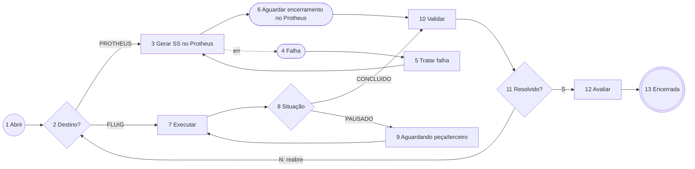

# Spec — ChamadoManutencao (Solicitação de Manutenção/Serviço) · Tatu Marchesan

**Status:** 🟡 RASCUNHO v0.2, aguardando validação · 13/11/2026
**Mudança da v0.1 → v0.2:** realinhada ao **levantamento de 15/10** (ver `../../requisitos-atas-2026-11-13.md`).
- **Sem aprovação** (decisão do cliente): saem os 3 níveis e o loop de aprovação.
- **Destino e responsável vêm de regras parametrizadas no Protheus**: o catálogo próprio no Fluig sai e os campos passam a ser preenchidos pelas regras.
- A solicitação vai **direto para execução no Fluig** ou para **integração com o Protheus**, conforme a regra.
- Validação de **cadastros ativos** e de **usuário existente no Protheus**.

**Base:** levantamento 15/10, formulário "manutenção" (doc 102, `teste1`), padrões da Compra.
**Formulário:** `frm_chamado_manutencao` · **Dataset:** `dts_chamado_manutencao_JYNX`

> **[VALIDAR]** = suposição minha, sem confirmação nas atas.

## 1. Decisões do cliente (15/10)
| # | Decisão |
|---|---|
| D1 | "Solicitações de manutenção dispensam níveis de aprovação, direcionando o fluxo diretamente para execução ou integração" |
| D2 | "Direcionamento automatizado por regras parametrizadas no Protheus e a validação de cadastros ativos" |
| D3 | API de integração Fluig ↔ Protheus a desenvolver (Gabriel + Pedro/TOTVS) |
| D4 | Regra que consulta os usuários do Protheus para validar o acesso no Fluig |
| D5 | Carga em massa das regras de configuração (com o consultor TOTVS) |
| D6 | Acesso dos usuários de teste via Identity |

## 2. Hipótese de funcionamento **[VALIDAR com Pedro/TOTVS e consultor de Manutenção]**
As "regras parametrizadas" ficam no **Protheus**. [I] Provavelmente no módulo **Manutenção de Ativos (SIGAMNT)**, que tem a **Solicitação de Serviço (SS)** e a **Ordem de Serviço (OS)**. Para cada tipo de serviço, bem ou área, a regra diz:
- **destino:** `PROTHEUS` (gera SS/OS no MNT, executada por lá: manutenção de máquinas e ativos) ou `FLUIG` (executada e controlada no Fluig: serviços gerais, predial, TI **[VALIDAR]**);
- **responsável/equipe** que recebe a solicitação.

O Fluig consulta essas regras por um dataset (`dts_getRegrasManutencaoProtheus_MFX`, endpoint do Pedro) ao enviar a solicitação.

## 3. Fluxo (IDs provisórios)
| ID | Atividade | Tipo | Responsável |
|---|---|---|---|
| 1 | Abrir solicitação de manutenção | Início | Solicitante |
| 2 | Destino da solicitação? | Gateway | — |
| 3 | Gerar solicitação de serviço no Protheus | Atividade de serviço | — |
| 4 | Falha na integração | Captura de erro (na 3) | — |
| 5 | Tratar falha de integração | Tarefa | SUPORTE_FLUIG |
| 6 | Aguardar encerramento no Protheus | Intermediário condicional | — (verifica a situação da SS/OS) |
| 7 | Executar serviço | Tarefa | Responsável da regra |
| 8 | Situação da execução | Gateway | — |
| 9 | Aguardando peça/terceiro | Tarefa | Responsável da regra |
| 10 | Validar atendimento | Tarefa | Solicitante |
| 11 | Resolvido? | Gateway | — |
| 12 | Avaliar atendimento | Tarefa | Solicitante |
| 13 | Solicitação encerrada | Fim | — |

## 4. Regras de negócio
| # | Regra | Onde |
|---|---|---|
| RN01 | **Usuário (D4):** só abre solicitação quem existe e está ativo no Protheus (consulta por e-mail ou matrícula). Do contrário, bloqueia com mensagem | `validateForm` / `beforeTaskSave` na abertura |
| RN02 | **Cadastros ativos (D2):** bem/equipamento, centro de custo e tipo de serviço precisam estar ativos no Protheus | `beforeTaskSave` |
| RN03 | **Direcionamento (D2):** ao enviar, consulta a regra no Protheus e grava `hd_destino` (PROTHEUS/FLUIG), `hd_regra_codigo` e o responsável (`hd_loginExecutor` ou grupo) | `beforeTaskSave` |
| RN04 | Sem regra para a combinação informada → **[VALIDAR]** bloqueia ou cai num grupo padrão (ex.: `PCM_MANUTENCAO`) | `beforeTaskSave` |
| RN05 | **Destino Protheus:** a atividade 3 cria a SS no Protheus com os dados do formulário e grava o número da SS. Idempotente (não recria se já houver número) | `servicetask3` |
| RN06 | **Encerramento no Protheus:** a atividade 6 verifica periodicamente a situação da SS/OS. Encerrada → segue para validação **[VALIDAR]**: intermediário condicional ou tarefa manual "Confirmar encerramento" | Intermediário condicional |
| RN07 | **Destino Fluig:** o responsável executa e registra o que foi feito. Pode pausar (aguardando peça/terceiro) informando o motivo | `validateForm` |
| RN08 | Prazo (SLA) **[VALIDAR se existe]**: se houver, vem da regra do Protheus e é aplicado à tarefa com `calculateDeadLineHours` + `setDueDate` | `afterTaskCreate` |
| RN09 | **Não resolvido:** volta ao destino original (reabre SS no Protheus ou volta para a execução) e conta uma reabertura | `beforeTaskSave` |
| RN10 | Avaliação de 1 a 5 obrigatória; nota ≤ 2 exige comentário **[VALIDAR]** | `validateForm` |
| RN11 | Erro da integração copiado para o formulário ao entrar na 5 | `beforeStateEntry` |

## 5. Campos (do `teste1`, ajustados)
**Saem:** aprovação (`hd_servico_realizaAprov1..3`, `hd_servico_idAprovador1..3`, `hd_servico_aprovado1..3`) e catálogo próprio do Fluig. **Entram:** `hd_destino`, `hd_regra_codigo`, `hd_protheus_ss_numero`, `hd_protheus_os_numero`, `hd_protheus_status`, `hd_integracao_msg`, `hd_qtd_reaberturas`.

| Seção | Campos |
|---|---|
| Solicitante | `num_solicitacao`, `txt_solicitacao_data`, `hd_loginSolicitante`, `hd_solicitante_nome`, `hd_solicitante_email`, `hd_solicitante_filial`, `hd_solicitante_local` |
| Serviço | tipo/categoria do serviço (zoom nas regras do Protheus), `txta_servico_descricao`, anexos, `dt_preferencia` |
| Bem/equipamento | `hd_servico_codPatrimonio` (zoom no cadastro de bens do Protheus **[VALIDAR]** ST9/SN1), `hd_servico_descEquipamento`, `hd_servico_locEquip` |
| Prioridade **[VALIDAR se fica]** | `rdo_impacto`, `rdo_urgencia` |
| Direcionamento | `hd_destino`, `hd_regra_codigo`, `hd_loginExecutor` |
| Protheus | `hd_protheus_ss_numero`, `hd_protheus_os_numero`, `hd_protheus_status`, `hd_integracao_msg` |
| Execução (destino Fluig) | `sl_servico_status`, `txta_execucao_servico`, `txt_servico_tempoExecucao` |
| Validação e avaliação | `hd_validacao_procRealizado`, `hd_qtd_reaberturas`, `hd_avaliacao_solicNota`, `txta_desc_aval_solici` |

## 6. Dependências do Protheus (Pedro/TOTVS)
| Endpoint/dataset | Uso |
|---|---|
| Consulta de usuário ativo | RN01 |
| Consulta de regras de direcionamento | RN03/RN04 |
| Consulta de bens/equipamentos, CC e tipos de serviço ativos | RN02, zooms |
| Inclusão de Solicitação de Serviço (SS) | RN05 |
| Consulta da situação da SS/OS | RN06 |

## 7. Critérios de aceite
- **CA01:** Dado um usuário que não existe no Protheus, quando tentar abrir, então é bloqueado com mensagem.
- **CA02:** Dado um serviço cuja regra é destino PROTHEUS, quando o solicitante enviar, então uma SS é criada no Protheus e o número aparece no formulário, sem nenhuma aprovação.
- **CA03:** Dado um serviço cuja regra é destino FLUIG com responsável X, quando enviar, então a tarefa "Executar serviço" vai para X.
- **CA04:** Dado que a SS seja encerrada no Protheus, então a solicitação no Fluig avança para a validação do solicitante.
- **CA05:** Dado que o solicitante responda "não resolvido", então volta ao destino original e conta uma reabertura.
- **CA06:** Dado que a criação da SS falhe, então, após 3 tentativas, vai para "Tratar falha" com a mensagem visível.

## 8. Perguntas (atualizadas)
1. As "regras parametrizadas no Protheus" estão em qual rotina/tabela? É o SIGAMNT? Já existem ou serão criadas (carga em massa)?
2. Quais serviços vão para o Protheus (SS/OS) e quais são executados no Fluig?
3. Como o Fluig sabe que a OS foi encerrada no Protheus: consulta periódica ou o Protheus avisa?
4. Existe SLA por tipo de serviço? Fica no Protheus?
5. Impacto × urgência continua no formulário?
6. Bens: cadastro de bens do MNT (ST9) ou Ativo Fixo (SN1)?
7. Avaliação do atendimento: obrigatória?

## 9. Fontes TDN
- Atividades: https://tdn.totvs.com/display/public/fluig/Atividades+Workflow
- Intermediários (condicional): https://tdn.totvs.com/pages/releaseview.action?pageId=126714787
- Atividade de serviço e rollback: https://tdn.totvs.com/pages/releaseview.action?pageId=237397494
- Captura de erro: https://tdn.totvs.com/pages/releaseview.action?pageId=990755497
- hAPI: https://tdn.totvs.com/display/public/fluig/hAPI
