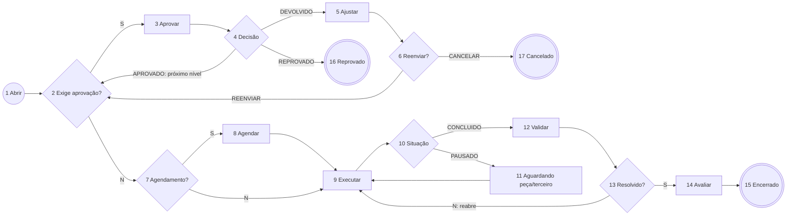

# Spec — ChamadoManutencao (Chamado de Manutenção/Serviço) · Tatu Marchesan

**Status:** 🟡 RASCUNHO, aguardando validação da Marchesan · **Versão:** 0.1 · 13/11/2026
**Base:** campos do formulário "manutenção" já publicado em DEV (doc 102, dataset `teste1`) e padrões do projeto.
**Formulário:** `frm_chamado_manutencao` (substitui o `teste1`) · **Dataset do formulário:** `dts_chamado_manutencao_JYNX`
**Pré-requisito:** formulário de cadastro **`frm_catalogo_servicos_manutencao`** (seção 6).

> Itens marcados **[VALIDAR]** são suposições minhas e precisam de confirmação do cliente.

## 1. Objetivo
Centralizar os pedidos de manutenção e serviços internos (manutenção predial, de máquinas, TI, facilities…) num **catálogo de serviços**. Cada serviço define a equipe responsável, o SLA, se exige aprovação (até 3 níveis) e se exige agendamento. O processo mede o SLA, com pausa e feriados, e coleta a validação e a avaliação do solicitante.

## 2. Papéis
| Papel | Quem | Como é definido |
|---|---|---|
| Solicitante | Qualquer colaborador | Usuário logado |
| Aprovador 1, 2, 3 | Definidos **por serviço** no catálogo | Campos `hd_servico_idAprovador1..3` + flags `realizaAprov1..3` |
| Equipe executora | Grupo Fluig do departamento (ex.: `MANUT_PREDIAL`, `MANUT_INDUSTRIAL`, `TI`) | Departamento do serviço no catálogo → grupo (pool). Um técnico **assume** a tarefa |
| Gestor do processo | PCM / coordenação de manutenção **[VALIDAR]** | Pode transferir e reabrir |

## 3. Fluxo
> IDs provisórios (gerados no desenho). Conferir com `fluig_parse_process` depois de salvar no Studio.

| ID | Atividade | Tipo | Responsável |
|---|---|---|---|
| 1 | Abrir chamado | Início | Solicitante |
| 2 | Exige (mais) aprovação? | Gateway | — |
| 3 | Aprovar chamado | Tarefa (repetida por nível) | Aprovador do nível atual (catálogo) |
| 4 | Decisão da aprovação | Gateway | — |
| 5 | Ajustar chamado | Tarefa | Solicitante |
| 6 | Reenviar ou cancelar? | Gateway | — |
| 7 | Serviço com agendamento? | Gateway | — |
| 8 | Agendar atendimento | Tarefa | Equipe do departamento |
| 9 | Executar serviço | Tarefa | Equipe do departamento (técnico assume) |
| 10 | Situação da execução | Gateway | — |
| 11 | Aguardando peça/terceiro (SLA pausado) | Tarefa | Equipe do departamento |
| 12 | Validar atendimento | Tarefa | Solicitante |
| 13 | Serviço resolvido? | Gateway | — |
| 14 | Avaliar atendimento | Tarefa | Solicitante |
| 15 | Chamado encerrado | Fim | — |
| 16 | Reprovado | Fim (cancelamento) | — |
| 17 | Cancelado pelo solicitante | Fim (cancelamento) | — |

**Como funcionam as aprovações em vários níveis:** uma única atividade (3) é repetida. Ao sair da abertura, ou depois de cada aprovação, o `beforeTaskSave` calcula o **próximo nível pendente** (1 → 2 → 3, pulando os níveis desligados no catálogo). Ele grava `hd_nivel_aprovacao_atual` e `hd_exige_aprovacao = S/N` e atribui a tarefa ao aprovador desse nível. Assim o diagrama fica pequeno, e 0, 1, 2 ou 3 níveis usam o mesmo desenho.

## 4. Regras de negócio
| # | Regra | Onde |
|---|---|---|
| RN01 | Departamento → categoria → subcategoria → serviço são escolhidos em cascata no catálogo (cada zoom filtra pelo anterior) | Formulário |
| RN02 | Escolher o serviço preenche, a partir do catálogo: SLA (horas), equipe, aprovadores 1–3 e flags de aprovação e de agendamento | Formulário (zoom) + conferência no `beforeTaskSave` (não confiar no cliente) |
| RN03 | Descrição obrigatória (mín. **[VALIDAR] 20** caracteres); patrimônio obrigatório quando o serviço é de equipamento **[VALIDAR]** | `validateForm` |
| RN04 | **Prioridade = matriz impacto × urgência** (Alto/Médio/Baixo × Alta/Média/Baixa) → P1–P4. **[VALIDAR]** se a prioridade **reduz o SLA** do serviço (ex.: P1 = 25% do SLA) ou é só informativa | `beforeTaskSave` |
| RN05 | **Prazo (SLA)** calculado ao entrar em "Executar" com `hAPI.calculateDeadLineHours` no expediente da Marchesan (feriados do Fluig) e aplicado na tarefa com `hAPI.setDueDate` | `afterTaskCreate` |
| RN06 | **Pausa de SLA:** ao ir para "Aguardando peça/terceiro", grava o início da pausa e exige o motivo. Ao voltar para "Executar", soma o tempo pausado e **recalcula o prazo**. O SLA nativo do Fluig não pausa, por isso o prazo é recalculado pelo evento | `beforeTaskSave` / `afterTaskCreate` |
| RN07 | Concluir a execução exige a descrição do que foi feito (`txta_execucao_servico`) e o tempo gasto | `validateForm` na atividade 9 |
| RN08 | Devolver ou reprovar exige parecer | `validateForm` na atividade 3 |
| RN09 | Se o solicitante disser que **não foi resolvido**, o chamado volta para "Executar" com o motivo e conta uma reabertura (`hd_qtd_reaberturas`) | `validateForm` / `beforeTaskSave` |
| RN10 | Avaliação obrigatória de 1 a 5; nota ≤ 2 exige comentário. **[VALIDAR]** se o técnico também avalia o solicitante (o formulário atual tem `hd_avaliacao_atendNota`) | `validateForm` |
| RN11 | Sem resposta do solicitante na validação em **[VALIDAR] 3 dias úteis**, o chamado é encerrado automaticamente como resolvido | Prazo na atividade 12 + job/evento (definir) |
| RN12 | O aprovador não pode ser o solicitante; nesse caso pula para o próximo nível **[VALIDAR]** | `beforeTaskSave` |

## 5. Formulário: campos
**Limpeza em relação ao `teste1`:** os campos de 3 aprovadores ficam (vêm do catálogo); entram `hd_nivel_aprovacao_atual`, `hd_exige_aprovacao`, `hd_decisao`, `hd_decisao_ajuste`, `hd_prioridade`, `hd_pausa_inicio`, `hd_tempo_pausado_min` e `hd_qtd_reaberturas`.

| Seção | Campos principais |
|---|---|
| Solicitante | `num_solicitacao`, `txt_solicitacao_data`, `txt_solicitacao_codSolicitante`, `hd_solicitante_nome`, `hd_solicitante_email`, `hd_solicitante_filial`, `hd_solicitante_local` |
| Serviço (catálogo) | `ztxt_servico_departamento`, `ztxta_categoria`, `ztxt_servico_subcategoria`, `ztxt_servico_servico` + códigos `hd_servico_cod*`, `hd_servico_tempoSLA`, `hd_servico_realizaAgenda`, `hd_servico_realizaAprov1..3`, `hd_servico_idAprovador1..3` |
| Equipamento | `hd_servico_codPatrimonio`, `hd_servico_descEquipamento`, `hd_servico_numSerieEquipamento`, `hd_servico_locEquip` |
| Prioridade | `rdo_impacto`, `rdo_urgencia`, `hd_prioridade`, `txta_impacto_descricao`, `txta_urgencia_descricao` |
| Descrição | `txta_servico_descricao`, `dt_preferencia`, anexos |
| Aprovação | `hd_nivel_aprovacao_atual`, `hd_exige_aprovacao`, `hd_decisao`, `hd_servico_aprovado1..3`, `txta_servico_observacao` (parecer) |
| Execução | `hd_loginExecutor`, `sl_servico_status`, `txta_execucao_servico`, `txt_servico_tempoExecucao`, `txt_servico_dataSLA`, `txt_servico_horarioSLA`, `hd_pausa_inicio`, `hd_tempo_pausado_min`, `hd_execucao_slaGasto` |
| Validação | `hd_validacao_procRealizado`, `hd_qtd_reaberturas`, `hd_dataConclusao` |
| Avaliação | `hd_avaliacao_solicNota`, `txta_desc_aval_solici`, `hd_dataConclusaoAvaliacao` |

## 6. Pré-requisito: catálogo de serviços
Formulário de cadastro **`frm_catalogo_servicos_manutencao`** (dataset `dts_catalogo_servicos_manutencao_JYNX`), mantido pelo PCM/TI:

| Campo | Exemplo |
|---|---|
| Departamento | Manutenção Industrial |
| Grupo Fluig executor | `MANUT_INDUSTRIAL` |
| Categoria / Subcategoria / Serviço | Máquinas / Solda / Reparo de máquina de solda |
| SLA (horas úteis) | 8 |
| Exige agendamento | Não |
| Aprovação nível 1/2/3 (sim/não + aprovador) | Sim: coordenador da área / Não / Não |
| Exige patrimônio | Sim |
| Ativo | Sim |

Datasets de zoom em cascata: `dts_getDepartamentosManutencao_MFX`, `dts_getCategoriasManutencao_MFX`, `dts_getServicosManutencao_MFX` (filtram o catálogo ativo).

**Patrimônio:** **[VALIDAR]**
- (a) consultar o **Ativo Fixo do Protheus (SN1)** com um dataset novo `dts_getPatrimonioProtheus_MFX`, reaproveitando a conexão REST da Compra; ou
- (b) cadastro de equipamentos no Fluig.

## 7. Eventos previstos
| Evento | Função |
|---|---|
| `validateForm` (formulário) | RN03, RN07, RN08, RN10 por atividade |
| `beforeTaskSave` | Próximo nível de aprovação e responsável (seção 3), prioridade (RN04), pausa e reabertura (RN06, RN09), autoaprovação (RN12) |
| `afterTaskCreate` | Prazo da tarefa "Executar" pelo SLA com `calculateDeadLineHours` + `setDueDate` (RN05, RN06) |
| `afterProcessCreate` | Número do chamado no formulário |

Esse processo **não integra com o Protheus**, salvo a consulta de patrimônio, se for a opção (a). Por isso pode ficar pronto antes do Reembolso.

## 8. Critérios de aceite
- **CA01:** Dado um serviço sem aprovação e sem agendamento, quando o solicitante abrir, então a tarefa vai direto para o pool da equipe do departamento, com prazo = SLA em horas úteis.
- **CA02:** Dado um serviço com aprovação nos níveis 1 e 3 (2 desligado), quando o nível 1 aprovar, então a tarefa vai para o aprovador do nível 3; quando ele aprovar, segue para execução.
- **CA03:** Dado um chamado em execução com prazo para sexta 17h, quando o técnico pausar por 4 horas úteis e retomar, então o novo prazo é sexta + 4 horas úteis.
- **CA04:** Dado que o solicitante responda "não resolvido", então o chamado volta para "Executar" com o motivo, e `hd_qtd_reaberturas` = 1.
- **CA05:** Dado uma avaliação com nota 2 sem comentário, então o envio é bloqueado.
- **CA06:** Dado um feriado cadastrado no Fluig no meio do prazo, então o prazo não conta esse dia.

## 9. Perguntas para a Marchesan (validação)
1. Quais departamentos atendem por este processo: só Manutenção (industrial/predial) ou também TI e facilities?
2. Quem mantém o catálogo de serviços? Já existe uma lista de serviços com SLA?
3. A prioridade (impacto × urgência) muda o prazo ou é só informativa?
4. Quais serviços exigem aprovação e de quem (coordenador, gerente, diretoria)?
5. Patrimônio: vem do Ativo Fixo do Protheus ou de uma planilha?
6. Prazo para o solicitante validar antes do encerramento automático?
7. O técnico avalia o solicitante também?
8. Horário de expediente da manutenção (turnos? 24×7 para manutenção industrial?)

## 10. Fontes TDN
- Atividades: https://tdn.totvs.com/display/public/fluig/Atividades+Workflow
- Gateways: https://tdn.totvs.com/display/public/fluig/Gateways
- Mecanismos de atribuição: https://tdn.totvs.com/pages/releaseview.action?pageId=270921079
- hAPI (`calculateDeadLineHours`, `setDueDate`): https://tdn.totvs.com/display/public/fluig/hAPI
- Eventos de processo: https://tdn.totvs.com/display/public/fluig/Eventos+de+Processos
