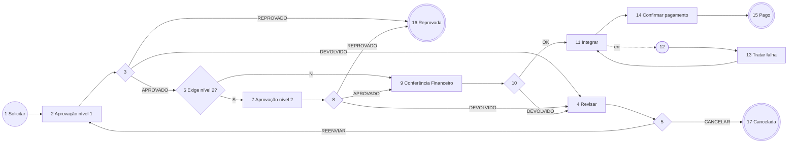

# Spec — SolicitacaoReembolso (Reembolso de Despesas) · Tatu Marchesan

**Status:** 🟡 RASCUNHO v0.2, aguardando validação · 13/11/2026
**Mudança da v0.1 → v0.2:** realinhada ao **levantamento de 16/10** (ver `../../requisitos-atas-2026-11-13.md`).
- O processo é **reembolso de despesas a colaborador**, substituindo o **Paytrack**. Pagamento a fornecedor e dados fiscais **saem** (decisão do cliente).
- Entram **câmbio** (despesa em dólar) e **cálculo automático de distância**.
- Aprovação em **2 níveis configuráveis pela hierarquia** (já era a proposta).

**Base:** levantamento 16/10, formulário "reembolso" (doc 104, `teste2`), padrões da Compra.
**Formulário:** `frm_solicitacao_reembolso` · **Dataset:** `dts_solicitacao_reembolso_JYNX`

> **[VALIDAR]** = suposição minha, sem confirmação nas atas.

## 1. Objetivo
Substituir o Paytrack no reembolso de despesas a colaboradores: lançamento das despesas com comprovantes, **categorias padronizadas**, conversão de **moeda estrangeira**, **quilometragem calculada automaticamente**, aprovação em dois níveis e envio ao sistema de destino para pagamento/contabilização.

## 2. Decisões do cliente (16/10)
| # | Decisão | Fonte |
|---|---|---|
| D1 | Formulário no Fluig centraliza anexos e automatiza aprovações por alçada | Ata 16/10 |
| D2 | **Duas etapas de aprovação** configuráveis conforme a hierarquia | Ata 16/10 |
| D3 | Despesas em **dólar**: manter o valor original e converter só para contabilização | Ata 16/10 |
| D4 | **Cálculo automático de distância** (como no sistema atual; o cliente envia o print) | Ata 16/10 |
| D5 | **Sem dados fiscais e sem dados de fornecedor**; ficam categorias, centro de custo e projeto (opcional) | Ata 16/10 |
| D6 | Categorias padronizadas | Ata 16/10 |

## 3. Papéis
| Papel | Quem | Como é definido |
|---|---|---|
| Solicitante | Colaborador | Usuário logado |
| Aprovador nível 1 | Gestor imediato / aprovador do CC **[VALIDAR]** | `dts_amarracaoAprovadores_JYNX` com `processo = "Reembolso"`, etapa nível 1 |
| Aprovador nível 2 | Próximo nível da hierarquia **[VALIDAR]**: sempre, ou só acima de um valor? | Mesmo cadastro, etapa nível 2 |
| Financeiro | Grupo `FINANCEIRO` **[VALIDAR]** quem confere | Pool de grupo |
| Suporte Fluig | Grupo `SUPORTE_FLUIG` | Falhas de integração |

## 4. Fluxo (IDs provisórios)
| ID | Atividade | Tipo | Responsável |
|---|---|---|---|
| 1 | Solicitar reembolso | Início | Solicitante |
| 2 | Aprovação nível 1 | Tarefa | Aprovador nível 1 |
| 3 | Decisão nível 1 | Gateway | — |
| 4 | Revisar solicitação | Tarefa | Solicitante |
| 5 | Reenviar ou cancelar? | Gateway | — |
| 6 | Exige nível 2? | Gateway | — |
| 7 | Aprovação nível 2 | Tarefa | Aprovador nível 2 |
| 8 | Decisão nível 2 | Gateway | — |
| 9 | Conferência do Financeiro | Tarefa | Grupo FINANCEIRO |
| 10 | Conferência OK? | Gateway | — |
| 11 | Integrar reembolso (destino a definir) | Atividade de serviço | — |
| 12 | Falha na integração | Captura de erro (na 11) | — |
| 13 | Tratar falha de integração | Tarefa | SUPORTE_FLUIG |
| 14 | Confirmar pagamento **[VALIDAR se existe]** | Tarefa | FINANCEIRO |
| 15 | Pago | Fim | — |
| 16 | Reprovada | Fim (cancelamento) | — |
| 17 | Cancelada | Fim (cancelamento) | — |

## 5. Regras de negócio
| # | Regra | Onde |
|---|---|---|
| RN01 | Cabeçalho: filial, **centro de custo** (obrigatório), **projeto** (opcional), período da despesa | `validateForm` |
| RN02 | Itens (pai × filho `tb_despesas`): data, **categoria** (lista padronizada), descrição, moeda, valor, comprovante (anexo) | `validateForm` |
| RN03 | **Câmbio (D3):** item em moeda ≠ BRL guarda o valor original + a taxa + o valor convertido. O **total da solicitação** soma os valores convertidos. Fonte da taxa: **[VALIDAR]** PTAX do dia da despesa, taxa do Protheus (SM2) ou taxa informada pelo colaborador com o comprovante da operadora do cartão | Formulário + `validateForm` |
| RN04 | **Quilometragem (D4):** categoria "Quilometragem" pede origem e destino → distância calculada automaticamente × **valor por km [VALIDAR]**. Serviço de distância: **[VALIDAR]** Google Distance Matrix (precisa de chave de API; o Fluig chama via Cadastro de Serviços) ou o mesmo provedor do Paytrack | Formulário + dataset `dts_calculaDistancia_MFX` |
| RN05 | Limites por categoria (ex.: refeição até R$ X/dia) **[VALIDAR]** | `validateForm` |
| RN06 | Aprovador de cada nível vem de `dts_amarracaoAprovadores_JYNX` (`processo = "Reembolso"`). Sem aprovador, o envio é bloqueado com mensagem | `beforeTaskSave` (mesmo padrão da Compra) |
| RN07 | **Nível 2 (D2):** "configurável conforme a hierarquia". Proposta: o cadastro diz, por CC/filial, se o nível 2 é **sempre** exigido ou só **acima de um valor** **[VALIDAR]** | `beforeTaskSave` |
| RN08 | O solicitante não aprova a própria solicitação (pula para o próximo nível) **[VALIDAR]** | `beforeTaskSave` |
| RN09 | Devolver ou reprovar exige parecer | `validateForm` |
| RN10 | O Financeiro confere os comprovantes e pode devolver | `validateForm` |
| RN11 | Integração idempotente: não reenvia se já houver protocolo/título | `servicetask11` |
| RN12 | Erro da integração copiado para o formulário ao entrar na 13 (o rollback apaga o `setCardValue` do servicetask) | `beforeStateEntry` |

## 6. Campos (limpeza do `teste2`)
**Saem (D5):** fornecedor (`*_fornecedor*`, `razao_social_*`, `cnpj_cpf_*`), dados fiscais e de controladoria (`controladoria_*`, chave de acesso, série, espécie, CT-e/frete), boleto, `itens_nota_json`, níveis Head/CEO/Diretor 2. Sai também o campo reservado `WKNumState` e os campos de erro e de etapa repetidos.

| Seção | Campos |
|---|---|
| Cabeçalho | `hd_num_solic`, `hd_data_solic`, `hd_solic_cod`, `hd_solic_nome`, `hd_solic_email`, `hd_etapa_atual` |
| Classificação | `hd_filial_codigo` (zoom `dts_getFilial_MFX`), `hd_ccusto_codigo` (zoom `dts_cCusto`), `hd_projeto_codigo` (opcional; zoom **[VALIDAR]** origem dos projetos) |
| Despesas (pai × filho `tb_despesas`) | `desp_data___N`, `desp_categoria___N`, `desp_descricao___N`, `desp_moeda___N`, `desp_valor_original___N`, `desp_taxa_cambio___N`, `desp_valor_brl___N`, `desp_km_origem___N`, `desp_km_destino___N`, `desp_km_distancia___N` |
| Totais | `valor_solicitacao` (soma em BRL) |
| Pagamento **[VALIDAR]** | dados bancários/PIX do colaborador (`chave_pix_reembolso`, `banco_reembolso`, `agencia_reembolso`, `conta_reembolso`, `tipo_conta_reembolso`) ou só o cadastro do Protheus/folha |
| Aprovação | `hd_decisao`, `hd_decisao_revisao`, `txta_parecer`, `hd_exige_nivel2`, `hd_aprov_nivel1`, `hd_aprov_nivel2` |
| Integração | `hd_integracao_status`, `hd_integracao_msg`, `hd_integracao_payload`, `hd_integracao_retorno`, `hd_integracao_protocolo` |

## 7. Integração (destino a definir)
Nas atas, o Paytrack integra hoje com o **Glovia**. Nada foi dito sobre o destino no Fluig. **[VALIDAR]** uma das opções:
- (a) **Protheus:** título a pagar ao colaborador (SE2, colaborador como fornecedor) e contabilização. Endpoint novo pelo Pedro, no padrão `/aprovcom/...`.
- (b) **Glovia:** manter o destino atual do Paytrack.
- (c) Folha de pagamento.

## 8. Critérios de aceite
- **CA01:** Dado um reembolso com 2 despesas em BRL e 1 em USD (US$ 50 à taxa 5,40), quando o colaborador enviar, então o total = soma BRL + R$ 270,00, e o valor original em USD fica registrado.
- **CA02:** Dado uma despesa de quilometragem de Matão a Ribeirão Preto, quando o colaborador informar origem e destino, então a distância é preenchida automaticamente e o valor = km × valor por km.
- **CA03:** Dado um CC sem aprovador de nível 1 para "Reembolso", então o envio é bloqueado com mensagem indicando o CC.
- **CA04:** Dado que o nível 2 seja exigido para o CC, quando o nível 1 aprovar, então a tarefa vai para o aprovador de nível 2.
- **CA05:** Dado que a integração falhe, então, após 3 tentativas, a solicitação vai para "Tratar falha" com a mensagem visível no formulário. Ao reenviar, não duplica.

## 9. Perguntas para a Marchesan (atualizadas)
1. **Nível 2:** sempre ou só acima de um valor? Quem é o nível 1 (gestor imediato ou aprovador do CC)?
2. **Destino:** o reembolso vai para o Protheus (título ao colaborador), para o Glovia ou para a folha?
3. **Câmbio:** fonte da taxa (PTAX, Protheus ou fatura do cartão)? Quais moedas além do dólar?
4. **Quilometragem:** valor por km? Pode usar a API do Google (exige chave de API)? Ida e volta?
5. **Categorias:** lista padronizada (a do Paytrack serve?) e limites por categoria?
6. **Projeto:** de onde vem a lista (Protheus? qual tabela)?
7. Existe adiantamento de viagem ou prestação de contas de cartão corporativo neste fluxo?
8. O Financeiro só confere ou também confirma o pagamento no Fluig?

## 10. Fontes TDN
- Atividades: https://tdn.totvs.com/display/public/fluig/Atividades+Workflow
- Gateways: https://tdn.totvs.com/display/public/fluig/Gateways
- Atividade de serviço e rollback: https://tdn.totvs.com/pages/releaseview.action?pageId=237397494
- Captura de erro: https://tdn.totvs.com/pages/releaseview.action?pageId=990755497
- Eventos de processo: https://tdn.totvs.com/display/public/fluig/Eventos+de+Processos
