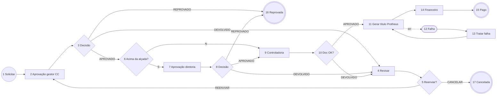

# Spec — SolicitacaoReembolso (Reembolso e Pagamento a Fornecedor) · Tatu Marchesan

**Status:** 🟡 RASCUNHO, aguardando validação da Marchesan · **Versão:** 0.1 · 13/11/2026
**Base:** campos do formulário "reembolso" já publicado em DEV (doc 104, dataset `teste2`), padrão do processo `solicitacaoDeCompra` (v28) e cadastro `dts_amarracaoAprovadores_JYNX`.
**Formulário:** `frm_solicitacao_reembolso` (substitui o `teste2`) · **Dataset do formulário:** `dts_solicitacao_reembolso_JYNX`

> Itens marcados **[VALIDAR]** são suposições minhas e precisam de confirmação do cliente antes do desenvolvimento.

## 1. Objetivo
Formalizar e aprovar dois tipos de saída de caixa, gerando o **título a pagar no Protheus** sem redigitação:
- **Reembolso de despesas a colaborador:** viagem, alimentação, combustível etc., pagas pelo colaborador.
- **Pagamento a fornecedor sem pedido de compra:** nota de serviço, boleto ou recibo. Inclui as despesas pagas com **cartão corporativo** só para prestação de contas. **[VALIDAR]** se cartão entra no escopo.

## 2. Papéis
| Papel | Quem | Como é definido |
|---|---|---|
| Solicitante | Qualquer colaborador | Usuário logado |
| Gestor do centro de custo | Aprovador por CC | `dts_amarracaoAprovadores_JYNX` (processo = "Reembolso", amarração = Centro de Custo, etapa = Supervisor) |
| Diretoria | Diretor da filial | Mesmo cadastro (amarração = Filial, etapa = Diretor) |
| Controladoria | Grupo Fluig `CONTROLADORIA` | Pool de grupo. **[VALIDAR]** quem faz parte |
| Financeiro | Grupo Fluig `FINANCEIRO` | Pool de grupo. **[VALIDAR]** quem faz parte |
| Suporte Fluig | Grupo Fluig `SUPORTE_FLUIG` | Trata falhas de integração (Jynx/TI) |

> **Simplificação proposta:** o formulário atual prevê até **6 níveis** (validador, gerente, head, diretor 1, diretor 2, CEO). Proponho começar com **2 níveis por alçada** (gestor do CC → diretoria acima do limite), o mesmo modelo que a Marchesan já usa na Compra. **[VALIDAR]** se Head e CEO existem na Marchesan. Se existirem, entram como níveis extras por faixa de valor.

## 3. Fluxo
> IDs provisórios (gerados no desenho). Conferir com `fluig_parse_process` depois de salvar no Studio.

| ID | Atividade | Tipo | Responsável |
|---|---|---|---|
| 1 | Solicitar reembolso/pagamento | Início | Solicitante |
| 2 | Aprovação do gestor do centro de custo | Tarefa | Gestor do CC (cadastro de amarração) |
| 3 | Decisão do gestor | Gateway | — |
| 4 | Revisar solicitação | Tarefa | Solicitante |
| 5 | Reenviar ou cancelar? | Gateway | — |
| 6 | Acima da alçada do gestor? | Gateway | — |
| 7 | Aprovação da diretoria | Tarefa | Diretor da filial (cadastro de amarração) |
| 8 | Decisão da diretoria | Gateway | — |
| 9 | Conferência e classificação (Controladoria) | Tarefa | Grupo CONTROLADORIA |
| 10 | Documentação OK? | Gateway | — |
| 11 | Gerar título a pagar no Protheus | Atividade de serviço (automatizada, 3 tentativas) | — |
| 12 | Falha ao gerar título | Captura de erro (anexada à 11) | — |
| 13 | Tratar falha de integração | Tarefa | Grupo SUPORTE_FLUIG |
| 14 | Programar e confirmar pagamento (Financeiro) | Tarefa | Grupo FINANCEIRO |
| 15 | Pago | Fim | — |
| 16 | Reprovada | Fim (cancelamento) | — |
| 17 | Cancelada pelo solicitante | Fim (cancelamento) | — |



## 4. Regras de negócio
| # | Regra | Onde |
|---|---|---|
| RN01 | Tipo da solicitação obrigatório: `REEMBOLSO` ou `FORNECEDOR` (e `CARTAO`, se validado) | Formulário + `validateForm` |
| RN02 | **Reembolso:** o favorecido é o próprio colaborador, que precisa estar cadastrado como **fornecedor no Protheus (SA2)**. **[VALIDAR]** é assim que a Marchesan paga reembolso hoje? | Formulário (zoom de fornecedor filtrado pelo CPF do colaborador) |
| RN03 | **Fornecedor:** CNPJ/CPF, código/loja do Protheus, número e data do documento e anexo do documento fiscal ou boleto obrigatórios | `validateForm` na atividade 1/4 |
| RN04 | Itens de despesa (tabela pai × filho): data, categoria, descrição, valor e comprovante; **valor total = soma dos itens** (calculado, não digitado) | Formulário + `validateForm` |
| RN05 | Forma de pagamento: `PIX`, `TRANSFERENCIA` ou `BOLETO`. PIX exige chave; transferência exige banco/agência/conta/tipo; boleto exige anexo e linha digitável **[VALIDAR]** | `validateForm` |
| RN06 | Vencimento ≥ hoje + **[VALIDAR] N dias úteis** (prazo mínimo do Financeiro) | `validateForm` |
| RN07 | Aprovadores tirados de `dts_amarracaoAprovadores_JYNX` com `processo = "Reembolso"`. Sem aprovador cadastrado, a solicitação **não sai** do início, com mensagem clara | `beforeTaskSave` (mesmo padrão da Compra) |
| RN08 | **Alçada:** `hd_exige_diretoria = S` quando o valor total passa do `valor_limite` do gestor no cadastro | `beforeTaskSave` ao sair da atividade 2 |
| RN09 | O solicitante não aprova a própria solicitação: se o aprovador for o solicitante, vai para o nível seguinte **[VALIDAR]** | `beforeTaskSave` |
| RN10 | Devolver ou reprovar exige parecer (`txta_parecer`) | `validateForm` nas atividades 2, 7 e 9 |
| RN11 | A Controladoria informa **natureza**, **condição de pagamento** e, para fornecedor, **espécie/série/chave da NF** antes de aprovar | `validateForm` na atividade 9 |
| RN12 | O título só é gerado uma vez: se `hd_protheus_id_titulo` estiver preenchido, a atividade 11 não reenvia (idempotência, a mesma lição da Compra) | `servicetask11` |
| RN13 | Na falha de integração, a mensagem do Protheus é copiada para o formulário ao entrar na atividade 13 (o rollback apaga o `setCardValue` feito no servicetask) | `beforeStateEntry` |
| RN14 | Na atividade 14, o Financeiro informa a data do pagamento. **[VALIDAR]** se consultamos a **baixa no Protheus** automaticamente em vez de confirmar à mão | Tarefa ou serviço |

## 5. Formulário: campos
**Limpeza em relação ao `teste2`:** remove o campo `WKNumState` (nome reservado), os 3 campos de erro de integração (fica só `hd_integracao_protheus_msg`), os 4 de etapa (fica só `hd_etapa_atual`) e o duplicado `hd_codAvalidador`. Os campos de Head/CEO e de frete/CT-e saem até a validação.

| Seção | Campos principais |
|---|---|
| Cabeçalho | `hd_num_solic`, `hd_data_solic`, `hd_solic_cod`, `hd_solic_nome`, `hd_solic_email`, `hd_etapa_atual` |
| Classificação | `hd_tipo_solicitacao`, `hd_filial_codigo` (zoom `dts_getFilial_MFX`), `hd_ccusto_codigo` (zoom `dts_cCusto`) |
| Favorecido | `hd_cod_fornecedor`, `hd_loja_fornecedor`, `hd_cnpj_cpf_fornecedor`, `razao_social_fornecedor` (zoom **novo** `dts_getFornecedoresProtheus_MFX`) |
| Documento (fornecedor) | `tipo_documento`, `numero_documento`, `dt_emissao_nota`, `controladoria_serie`, `controladoria_chave_acesso`, anexo obrigatório |
| Itens (pai × filho `tb_itens`) | `item_data___N`, `item_categoria___N`, `item_descricao___N`, `item_valor___N` |
| Totais | `valor_solicitacao` (calculado) |
| Pagamento | `formaPagamento`, `chave_pix`, `banco_transf`, `agencia_transf`, `conta_transf`, `tipo_conta_transf`, `financeiro_data_vencimento` |
| Aprovação | `hd_decisao`, `hd_decisao_revisao`, `txta_parecer`, `hd_exige_diretoria`, `hd_aprov_gestor`, `hd_aprov_diretor` |
| Controladoria | `controladoria_natureza` (zoom **novo** `dts_getNaturezasProtheus_MFX`), `controladoria_cond_pagamento` (zoom **novo** `dts_getCondPagtoProtheus_MFX`), `controladoria_especie` |
| Integração | `hd_integracao_protheus_status`, `hd_integracao_protheus_msg`, `hd_integracao_protheus_payload`, `hd_integracao_protheus_retorno`, `hd_protheus_id_titulo` |
| Financeiro | `hd_protheus_dt_baixa`, `hd_protheus_baixado` |

## 6. Integrações e datasets
| Item | Situação | Ação |
|---|---|---|
| Chamada REST autenticada ao Protheus | ✅ existe (`dts_consultaRestProtheus_MFX`, `dts_getTokenProtheus_MFX`) | Reaproveitar |
| Filial, centro de custo, colaboradores | ✅ existem | Reaproveitar |
| Matriz de aprovadores | ✅ existe (`dts_amarracaoAprovadores_JYNX`) | Cadastrar linhas com processo "Reembolso" |
| Fornecedores (SA2) | ❌ | Novo dataset `dts_getFornecedoresProtheus_MFX` |
| Naturezas (SED) | ❌ | Novo dataset `dts_getNaturezasProtheus_MFX` |
| Condições de pagamento (SE4) | ❌ | Novo dataset `dts_getCondPagtoProtheus_MFX` |
| **Geração do título a pagar (SE2 / FINA050)** | ❌ endpoint não existe | **Time Protheus:** criar `POST /aprovcom/geratitulo` (ou equivalente). Contrato proposto abaixo |
| Consulta de baixa (SE2) | ❌ | Opcional (RN14) |

**Contrato proposto: `POST /aprovcom/geratitulo`** **[VALIDAR com o time Protheus]**
```json
{
  "empresa": "01", "filial": "0101",
  "prefixo": "FLG", "numero": "<nº solicitação Fluig>", "parcela": "", "tipo": "<RC|NF|BOL>",
  "fornecedor": "<A2_COD>", "loja": "<A2_LOJA>",
  "natureza": "<ED_CODIGO>", "emissao": "AAAAMMDD", "vencimento": "AAAAMMDD",
  "valor": 0.00, "centroCusto": "<CTT_CUSTO>",
  "historico": "Fluig <nº> - <tipo>", "formaPagamento": "<PIX|TED|BOL>",
  "fluigProcesso": "<nº>"
}
```
Resposta esperada: `{"success": true, "titulo": {"prefixo": "...", "numero": "...", "parcela": "...", "tipo": "..."}}` ou `{"success": false, "erro": "...", "detalhes": [...]}`.

## 7. Eventos previstos
| Evento | Função |
|---|---|
| `validateForm` (formulário) | RN01–RN06, RN10, RN11 por atividade |
| `beforeTaskSave` | Atribuição dos aprovadores (RN07), alçada (RN08), autoaprovação (RN09), etapa atual |
| `servicetask11` | Gera o título (RN12), grava status, payload e retorno no sucesso, `throw` com mensagem útil na falha |
| `beforeStateEntry` | Copia o erro do complemento para o formulário ao entrar na 13 (RN13) |
| `afterProcessCreate` | Número da solicitação no formulário |

## 8. Critérios de aceite
- **CA01:** Dado um reembolso de R$ 300 no CC 640000 (gestor Paulo, limite R$ 500), quando o solicitante enviar, então vai para Paulo e, ao aprovar, segue direto para a Controladoria.
- **CA02:** Dado um reembolso de R$ 800 no mesmo CC, quando Paulo aprovar, então vai para a diretoria da filial 0101.
- **CA03:** Dado um CC sem aprovador para "Reembolso", quando o solicitante enviar, então o envio é bloqueado com mensagem indicando o CC sem aprovador.
- **CA04:** Dado que o gestor devolva sem parecer, então o envio é bloqueado; com parecer, a solicitação volta ao solicitante na atividade 4.
- **CA05:** Dado que a Controladoria aprove com natureza e condição preenchidas, então o título é criado no Protheus e o número fica em `hd_protheus_id_titulo`.
- **CA06:** Dado que o Protheus recuse o título, então, após 3 tentativas, a solicitação vai para "Tratar falha" com a mensagem do Protheus visível no formulário. Ao reenviar, não duplica o título.
- **CA07:** Dado um pagamento a fornecedor sem anexo do documento fiscal, então o envio é bloqueado.

## 9. Perguntas para a Marchesan (validação)
1. Quais tipos entram: reembolso, fornecedor sem pedido, cartão corporativo?
2. Como o reembolso é pago hoje: colaborador cadastrado como fornecedor no Protheus? Via folha?
3. Níveis de aprovação reais: gestor do CC + diretoria bastam? Existem Head e CEO? Quais limites de valor?
4. Quem compõe Controladoria e Financeiro?
5. Prazo mínimo de vencimento e regras de forma de pagamento (aceita boleto? PIX só para CPF?)
6. Categorias de despesa (lista fixa? mapeada para natureza?) e limites por categoria (ex.: alimentação até R$ X/dia)?
7. Frete/CT-e entra neste processo ou fica no fiscal?
8. A confirmação de pagamento deve ser automática pela baixa no Protheus?

## 10. Fontes TDN
- Atividades: https://tdn.totvs.com/display/public/fluig/Atividades+Workflow
- Gateways: https://tdn.totvs.com/display/public/fluig/Gateways
- Mecanismos de atribuição: https://tdn.totvs.com/pages/releaseview.action?pageId=270921079
- Atividade de serviço e rollback: https://tdn.totvs.com/pages/releaseview.action?pageId=237397494
- Captura de erro: https://tdn.totvs.com/pages/releaseview.action?pageId=990755497
- Eventos de processo: https://tdn.totvs.com/display/public/fluig/Eventos+de+Processos
